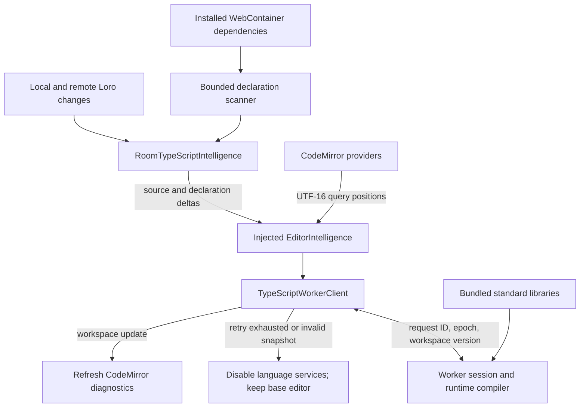

# TypeScript intelligence

[Architecture](architecture.md) · [Development](development.md)

Tsugite keeps TypeScript analysis in the browser. CodeMirror, Vim, and Loro
remain the owners of editing and shared document state; the language-service
layer receives versioned data and returns serializable results.

## Runtime

`RoomTypeScriptIntelligence` owns one lazily started Worker per room session.
`EditorIntelligence` exposes asynchronous pure-data queries for hover,
completion, signature help, diagnostics, and navigation. The client validates
paths, revisions, request IDs, and cancellation before applying a reply.

The Worker uses `typescript-legacy` 6.0.3 with a versioned in-memory host and
explicit standard libraries. Tooling TypeScript is independent. The compiler is
loaded lazily in the Worker, so a normal editor session does not pull compiler
objects onto the main thread. Cancellation rejects late results but cannot
preempt synchronous compiler work already running in the Worker.

The room owner publishes unopened and remotely edited files as well as the
active file. File and workspace versions prevent stale epochs, revisions, and
cancelled queries from replacing current results. Parsing is deferred until a
query needs a snapshot. Diagnostics wait 200 ms after edits and refresh when
declarations or workspace snapshots change. Navigation is capped at 10,000
locations, and replies carry one source snapshot per path so repeated
references do not duplicate whole files across the RPC boundary.

## Resource limits

| Resource                                  | Limit                                                                           |
| ----------------------------------------- | ------------------------------------------------------------------------------- |
| Project source                            | 512 files, 1 MiB per file, 16 MiB total UTF-8 text                              |
| Project declarations and package metadata | 1,024 files, 1 MiB per declaration, 64 KiB per metadata file, 8 MiB total       |
| Declaration scan                          | 8,192 traversed entries, 16 MiB serialized output, two-second deadline          |
| Worker requests                           | Queue of 32; two-second query and initialization deadlines                      |
| Navigation result                         | 10,000 locations; 24 MiB of unique source snapshots per reply                   |
| Worker recovery                           | One retry per room session; a valid replacement can recover a rejected snapshot |

The standard-library loader follows the official `lib.es2022.full.d.ts`
reference graph from bundled assets under the reserved `__typescript/`
namespace. After dependency installation, and when source imports change, the
WebContainer scanner reads only declarations and package metadata, including
package type entries and `@types` companions.

The browser import index caches references until file text changes and yields
between files after an eight-millisecond time slice. Concurrent scans cannot
restore stale import keys after newer edits or preview teardown. The scanner is
filesystem-only, bounds reads before allocation, and rejects unsafe paths and
escaping symlinks. It never evaluates arbitrary type CDNs or package code.

Reinstall clears stale declarations; loading and unavailable states are visible.
Scan failure clears project dependency types. An imported package without its
own declarations, companion types, or an ambient module marks project
declarations unavailable. This package-level check does not replace TypeScript
entry-point and subpath resolution.

An oversized or unsafe snapshot is rejected. Publishing a corrected snapshot
within the limits clears that rejection; a Worker that exhausts its single
session retry remains disabled and is not revived by a later snapshot.

## Replacement gate

The engine replacement in [#71](https://github.com/BBboy01/Tsugite/issues/71)
requires an official browser-compatible TypeScript 7 API and distribution.
Keep this Worker contract stable until that gate and equivalent functional and
performance checks pass.
